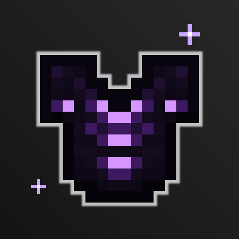

<h1 align="center">Wyrmwing</h1>

An end-game armor forged from dragon scales: fly with the full set, wrapped in a dragon aura

  
  
  
  
  
  

Defeat the Ender Dragon, collect its scales and upgrade your netherite armor into Wyrmwing: tougher, faster and able to fly when you wear all four pieces.

## Wyrm Scales

- The Ender Dragon gives Wyrm Scales to every nearby player each time it dies

## Crafting

- Wyrmwing Upgrade: a smithing template crafted from diamonds, a Wyrm Scale and End Stone
- Upgrade each piece of netherite armor with the template and a Wyrm Scale in a smithing table

## The armor

- Tougher and more durable than netherite, and it does not burn
- Every piece: +2.5% speed and +0.5 attack damage
- Helmet: breathe underwater. Boots: no fall damage
- The lilac lines of the armor glow in the dark

## Full set

- Creative flight while you wear all four pieces
- A dragon aura around you, with particle wings while you fly

## Configuration

Flight with the full set, the dragon aura, your own aura in first person (off by default so it never blocks your view), the glowing armor and the Wyrm Scales each player gets from the dragon can all be changed in the mod config.

## Dependencies

<strong>Fabric/Quilt:</strong>

- <a href="https://modrinth.com/mod/fabric-api">Fabric API</a>
- <a href="https://modrinth.com/mod/modmenu">Mod Menu</a> <strong>(Optional)</strong>

  
More screenshots

